<p align="center">
  
</p>
<h1 align="center">QuotaNest</h1>
<p align="center">AI quotas, accounts, and Claude Code HUD — together on your Mac.</p>
<p align="center">
  <a href="README.zh-CN.md"></a>
</p>
<p align="center">
  
  
  
  
</p>

> A native macOS menu-bar app for keeping track of AI account quotas, viewing usage in a floating panel, reusing existing credentials, and choosing what appears in Claude Code HUD.

## The 10-second pitch

Stop switching between provider dashboards just to find out which account still has room. QuotaNest puts your quota windows, balances, account controls, and schedules in one place — with four floating layouts when you want the numbers to stay visible.

**Existing credentials stay at their source.** Imports from 9router, cc-switch, CPAMP, and Magpie use read-only references instead of creating another persistent credential copy.

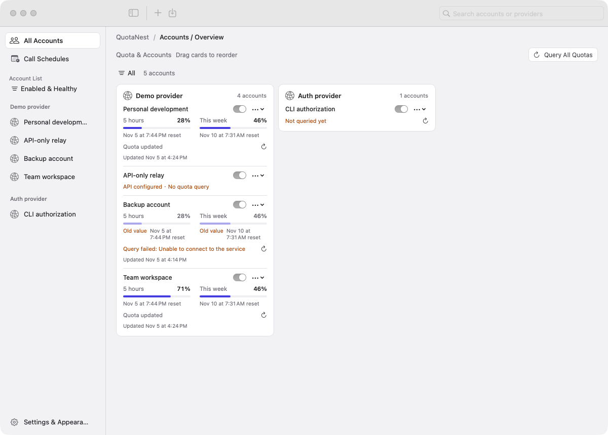

## Demo video · 27 seconds

https://github.com/user-attachments/assets/fc02bbbb-19f0-4373-a21b-ed4076c4e8b5

[Watch / download the English MP4](docs/videos/quotanest-demo-en.mp4) · [中文版视频](docs/videos/quotanest-demo-zh-CN.mp4)

The demos use the current native app with isolated sample accounts and illustrative quota values. They do not send paid model requests. Video production follows the screenshot → GSAP → HyperFrames approach used by [CCS](https://github.com/biedongbin/claude-code-session-manager); reproducible sources and the verified toolchain are in [docs/video-source](docs/video-source/README.md).

## What you get

| Capability | What it does |
| --- | --- |
| Multi-account overview | View quota windows, balances, reset times, old data, and configuration health without opening each provider site. |
| 55 built-in types | 22 types declare quota queries and model calls; 33 currently support quota queries only. See the [provider catalog](docs/provider-catalog.md). |
| Auth or API Key | Use the authentication modes declared by each provider. Quota queries inherit the same base authentication. |
| Read-only imports | Reference existing records from 9router, cc-switch, CPAMP, or Magpie, preserving original record and provider IDs. |
| Source synchronization | Check imported references hourly while the app runs, or sync now. Correct changed record IDs only when the identity is uniquely established. |
| Four floating layouts | Card, glass, compact, and list; drag from anywhere. The title appears on click and hides five seconds after the pointer leaves. |
| Claude Code HUD | Choose displayed accounts in settings or the account display page; both controls share the same preference. |
| Small scheduled calls | Configure local-time requests for eligible plans with dynamic usage windows. Calls consume quota and cannot guarantee opening or resetting a window. |
| English / 中文 | Change the interface language immediately in Settings & Appearance. The app follows the macOS light/dark appearance. |
| History migration | Automatically migrate the former TokenHUD account directory and preferences to QuotaNest with verification, backup, and rollback. |

## Install from source

Requirements: **macOS 14+**, the **Swiftly-managed Swift toolchain**, and **Node.js** for the bundled JavaScript quota adapters. Node.js 18+ is recommended.

```zsh
git clone https://github.com/biedongbin/QuotaNest.git
cd QuotaNest
export PATH="$HOME/.swiftly/bin:$PATH"
zsh scripts/package.sh
open ~/Applications/QuotaNest.app
```

Quit a running copy before packaging. The script builds a local app, includes its icon and resources, applies an ad-hoc signature, and installs it in `~/Applications`. This is a local build workflow; a notarized download is not assumed.

The system Command Line Tools Swift version can be incompatible with this package's manifest ABI. Use `swiftly run swift …` rather than switching toolchains mid-build.

## Interface tour

Screenshots show isolated demo data, not personal credentials or live service validation. Provider-returned text and user-defined account names remain unchanged when switching languages.

### 1. Choose a provider type

Search built-in types and inspect their authentication and quota/call capabilities before creating an account. Choosing a type opens a draft; it does not immediately create an account.

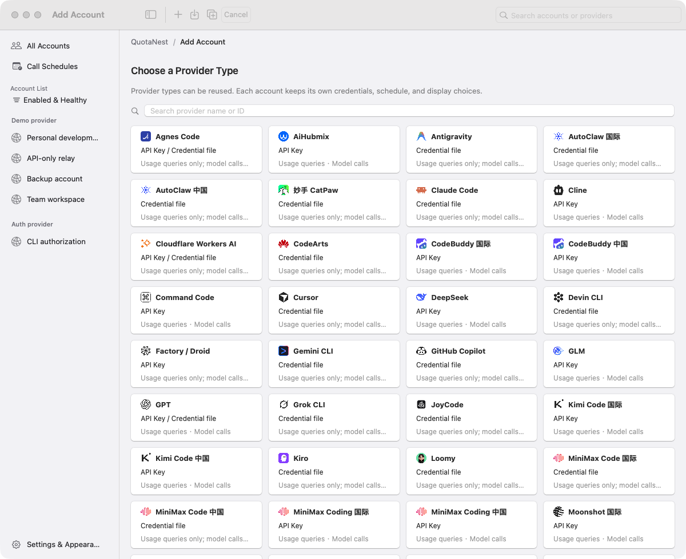

### 2. Connect with an API Key or an existing Auth file

Each provider determines which modes are supported. Auth references declared JSON credential layouts; API Key accounts use their configured base connection. Quota queries reuse that authentication instead of asking for a separate query key.

| API Key connection | Existing Auth file |
| --- | --- |
| 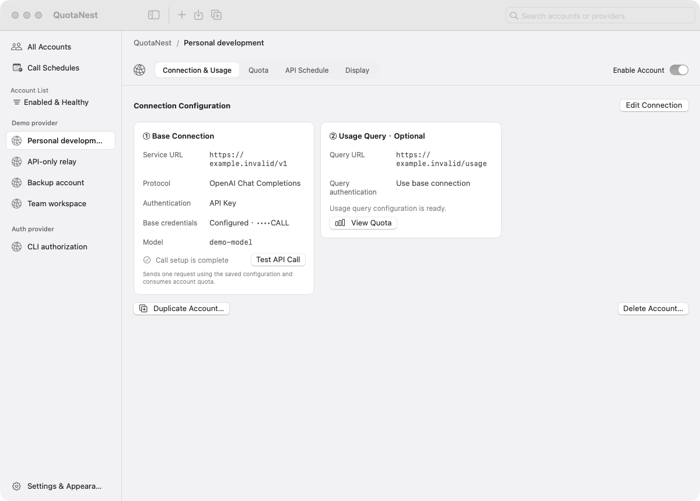 | 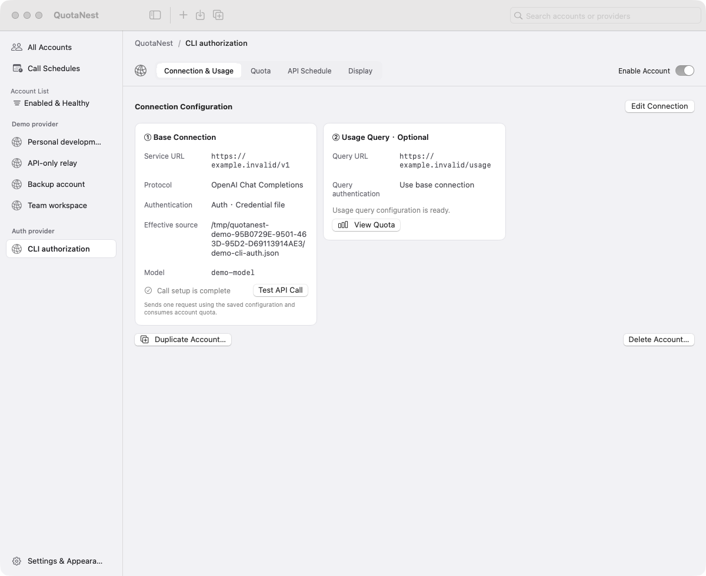 |

<details>
<summary>Account editor and API-only account</summary>

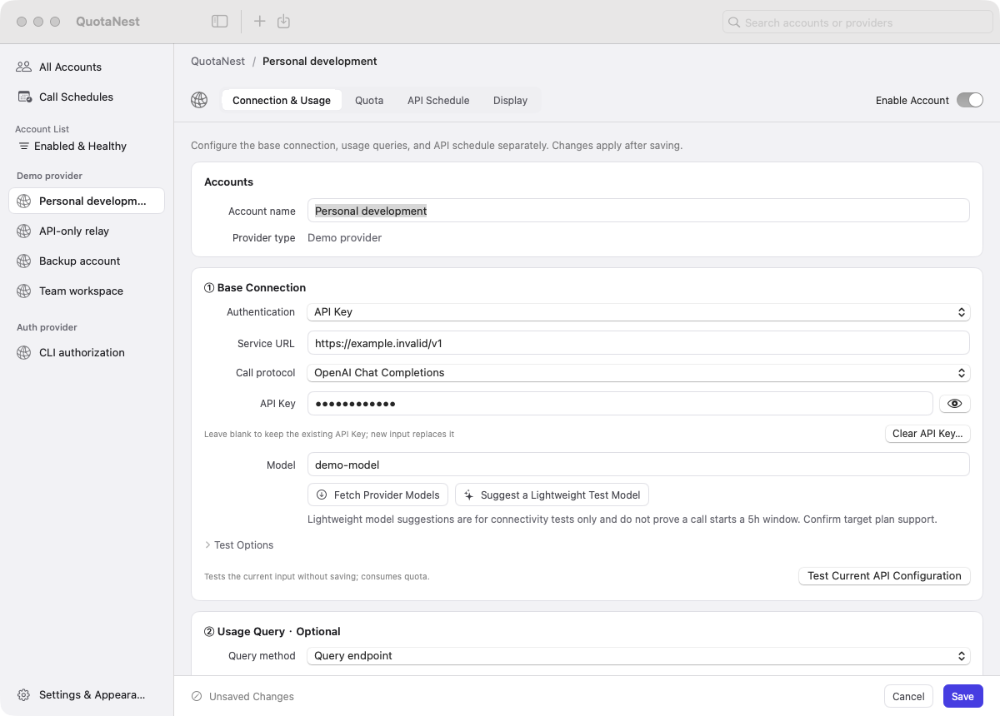

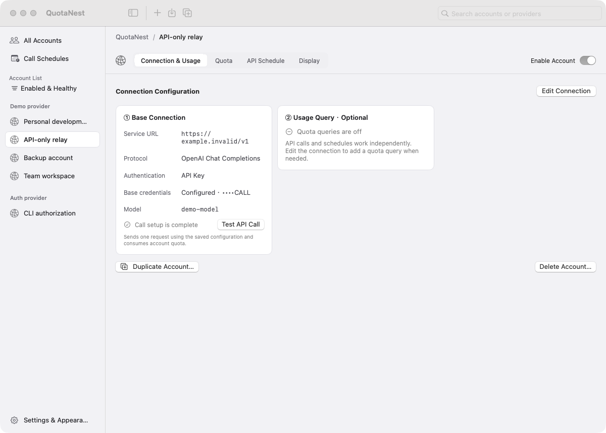

</details>

### 3. Inspect quota and schedule requests

Quota details keep the billing windows and account identity separate. Missing values stay unknown; a failed request is not presented as a successful refresh.

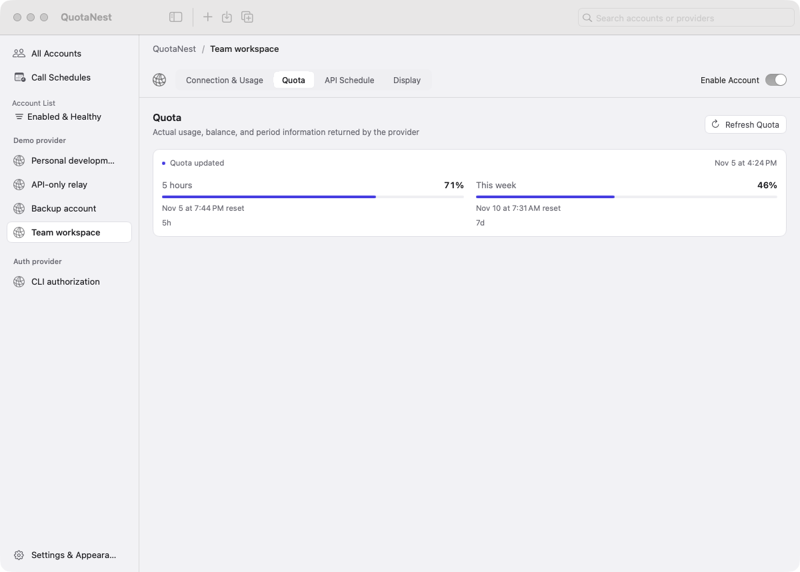

For supported types, select a model that belongs to the intended plan or quota pool, then configure local-time calls. A small request can **attempt** to start a first-use window when the provider supports that behavior. It is not a reset command, and every request may consume quota.

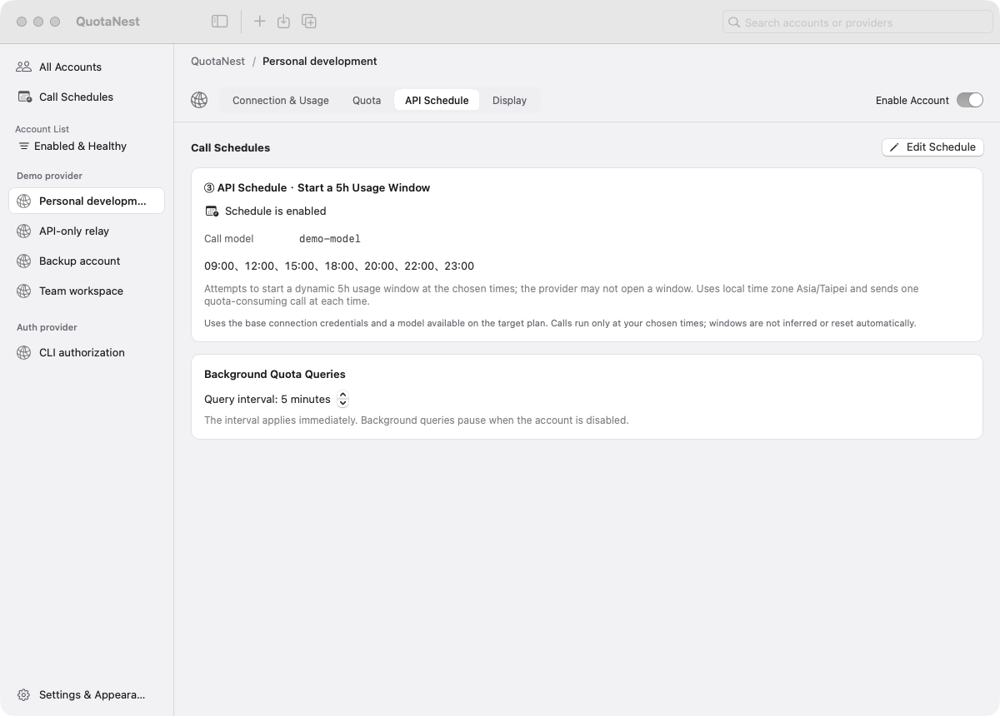

<details>
<summary>All schedules</summary>

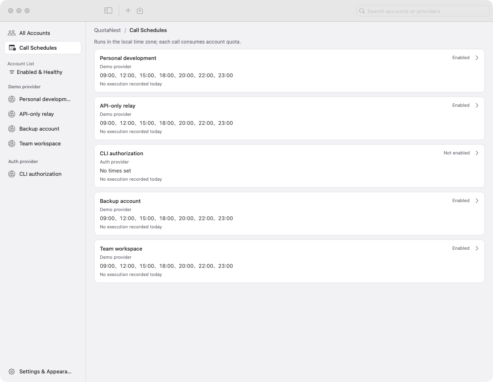

</details>

### 4. Import existing accounts

Import previews show the source tool, provider identity, source record ID, authentication mode, quota adaptation, and import status. Unsupported or unadapted rows are disabled; the column header stays visible while scrolling.

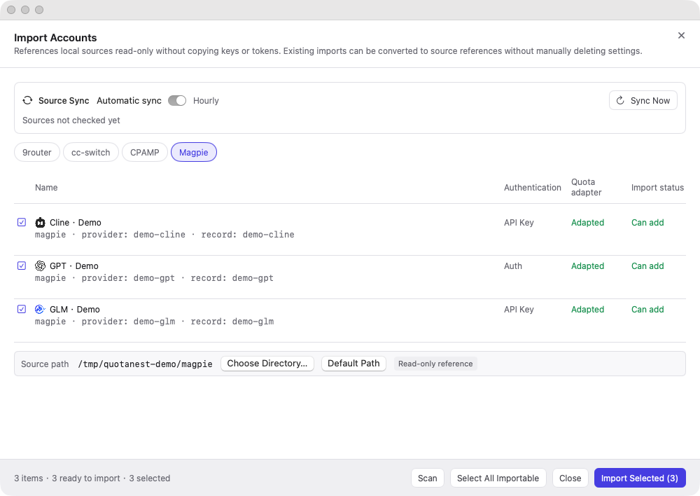

| Source | Current boundary |
| --- | --- |
| 9router | References `providerConnections` records by original primary key and provider identity; the authentication layout must be adapted. |
| cc-switch | Currently supports the Claude namespace, identified by `id + app_type`. Other namespaces are shown as unsupported. |
| CPAMP | References supported CPA JSON authorization files by filename and type. |
| Magpie | Supports adapted provider keys and plugin credential slots; preserves original provider IDs and supports an explicit portable configuration directory. Native CLI/Keychain-owned logins are not imported. |

Imported connection fields are read-only. Maintain credentials in the source tool; local monitoring, visibility, quota queries, and removing the association remain available. Deleting the association does not delete the source.

Automatic synchronization runs hourly **while QuotaNest is running**. A source record ID is corrected only with a unique, compatible identity match. Ambiguous records, missing evidence, or simultaneous ID/token changes without a trustworthy relationship need manual review. Source checks do not make model calls.

### 5. Keep quotas visible — all four floating styles

All layouts share the same account data and official provider brand mapping. Color marks retain their colors; monochrome marks adapt to appearance.

| Card | Glass |
| --- | --- |
| 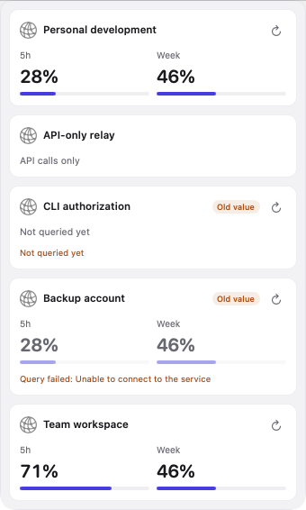 | 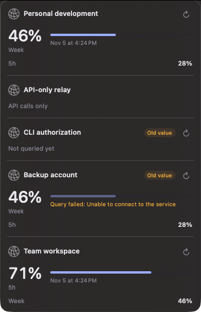 |

| Compact | List |
| --- | --- |
| 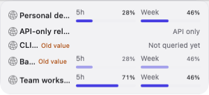 | 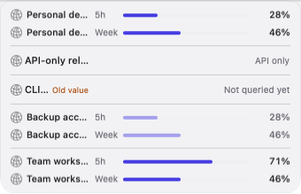 |

- **Card:** side-by-side quota windows in an account card.
- **Glass:** the highest-used window takes priority, with the remaining periods below.
- **Compact:** narrow rows with a small gap and no separator lines.
- **List:** aligned account, period, progress, and value columns with account separators.

Click the menu-bar item for the overview, double-click it to toggle the floating panel, or right-click for actions. Drag anywhere on the floating panel. Its title starts hidden, appears when clicked, and hides five seconds after the pointer leaves; returning cancels that timer. Appearance follows macOS — there is no separate in-app theme switch.

<details>
<summary>Menu-bar overview</summary>

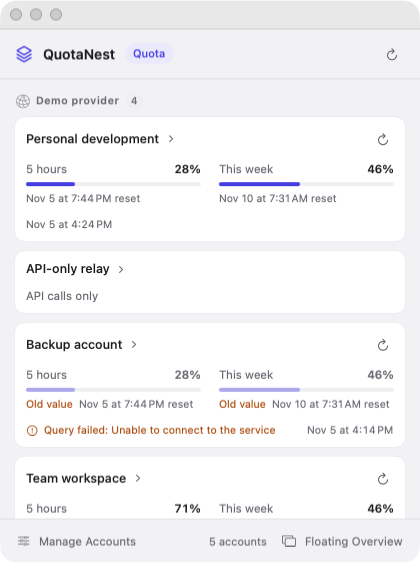

</details>

### 6. Select Claude Code HUD accounts and adjust preferences

Use **Settings & Appearance → Claude Code HUD** to select accounts horizontally with automatic wrapping. The account's **Display** page uses the same state. Changes sync immediately; a failed HUD write restores the previous selection. Disabled accounts retain their preference for when they are enabled again.

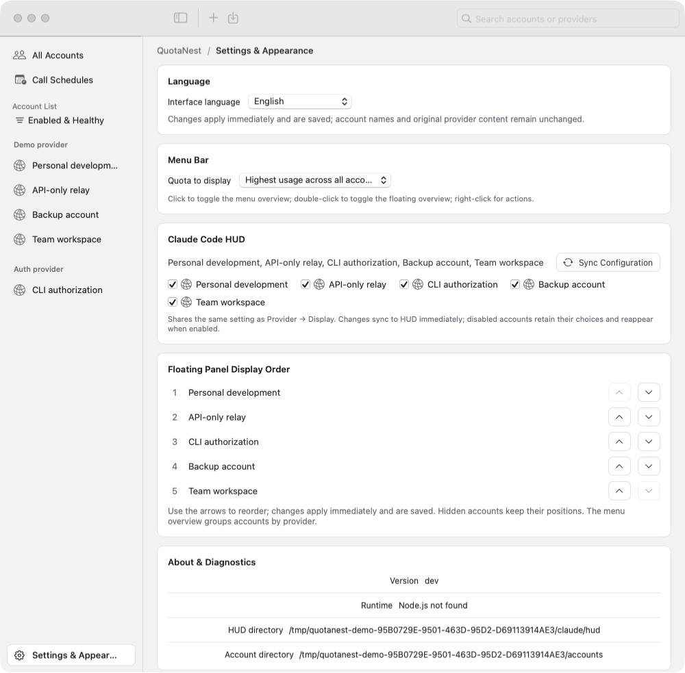

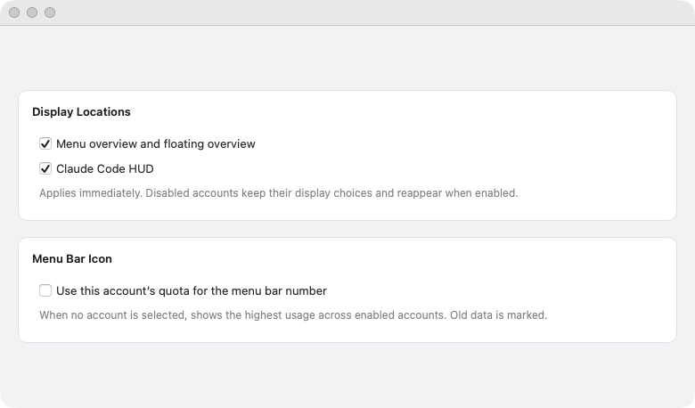

The following is a user-supplied Claude Code HUD example. Its project-directory line was removed before publication; the Chinese usage labels are retained as provided.

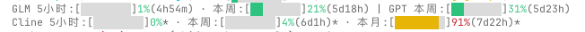

## Data, credentials, and migration

| Item | Location / behavior |
| --- | --- |
| Application | `~/Applications/QuotaNest.app` |
| Account manifests | `~/Library/Application Support/QuotaNest/providers/` |
| Preference domain | `local.quotanest` |
| Claude HUD integration | `~/.claude/hud/` and Claude's `settings.json`; `CLAUDE_CONFIG_DIR` is supported. |
| Previous TokenHUD data | Migrated before initializing language, account state, or background work. The original data is archived under `QuotaNest/MigrationBackups/`, with a migration report. |

Imported credentials are resolved from their source for the current request; persistent account settings store references. Manually configured API Keys are app-owned credentials and are stored with restrictive file permissions. External Auth files are not refreshed or overwritten.

Do not manually move source files to the app directory. Unsupported Keychain, encrypted, or unadapted credential formats do not become supported merely because they can be exported. The app does not provide a browser OAuth login flow.

## Custom quota endpoints

Custom accounts support **API Key authentication** with OpenAI-compatible or Anthropic-compatible model calls. Supply the complete quota URL; the default query is HTTP GET and inherits the base key. There is no independent quota key/cookie field and no guessed billing URL.

Standard quota JSON can include these fields, optionally wrapped in `data`:

```json
{
  "five_hour": { "used_percentage": 25, "resets_at": 1793462400 },
  "seven_day": { "used_percentage": 40 },
  "windows": [
    { "label": "Monthly", "amount": 12, "limit": 50, "unit": "USD" }
  ]
}
```

See the [provider catalog](docs/provider-catalog.md), [account/authentication contract](docs/account-management-rebuild.md), and [verification notes](docs/account-management-verification.md) for detailed boundaries. Built-in adaptation is not proof of live connectivity for every vendor or plan.

## Development and media reproduction

```zsh
export PATH="$HOME/.swiftly/bin:$PATH"
swiftly run swift build
# Choose the test suites appropriate to your change:
swiftly run swift test
```

To capture isolated demo screens without starting real queries or schedules:

```zsh
QUOTANEST_RENDER="$PWD/.build/demo-en" \
TOKENHUD_RENDER_ONLY=settings-light \
.build/debug/QuotaNest -quotanest.appLanguage en
```

The historical `TOKENHUD_RENDER_ONLY` environment name remains a diagnostic compatibility alias. Publication images are indexed in [the capture manifest](docs/screenshots/capture-manifest.json). Video commands, the CCS reference trail, and duration/codec checks are documented in [the video source guide](docs/video-source/README.md).

## Credits and brand assets

README organization and video production were informed by [claude-code-session-manager / CCS](https://github.com/biedongbin/claude-code-session-manager). Provider artwork comes from the documented Magpie/LobeHub distributions, matching product packages, and official website assets. Some types use an evidenced manufacturer/family mark rather than an exact product mark.

See [provider-logo provenance and third-party notices](Sources/TokenHUD/Resources/ProviderLogos/README.md). Trademarks and logo artwork remain the property of their respective owners; inclusion identifies a provider and does not imply endorsement.
