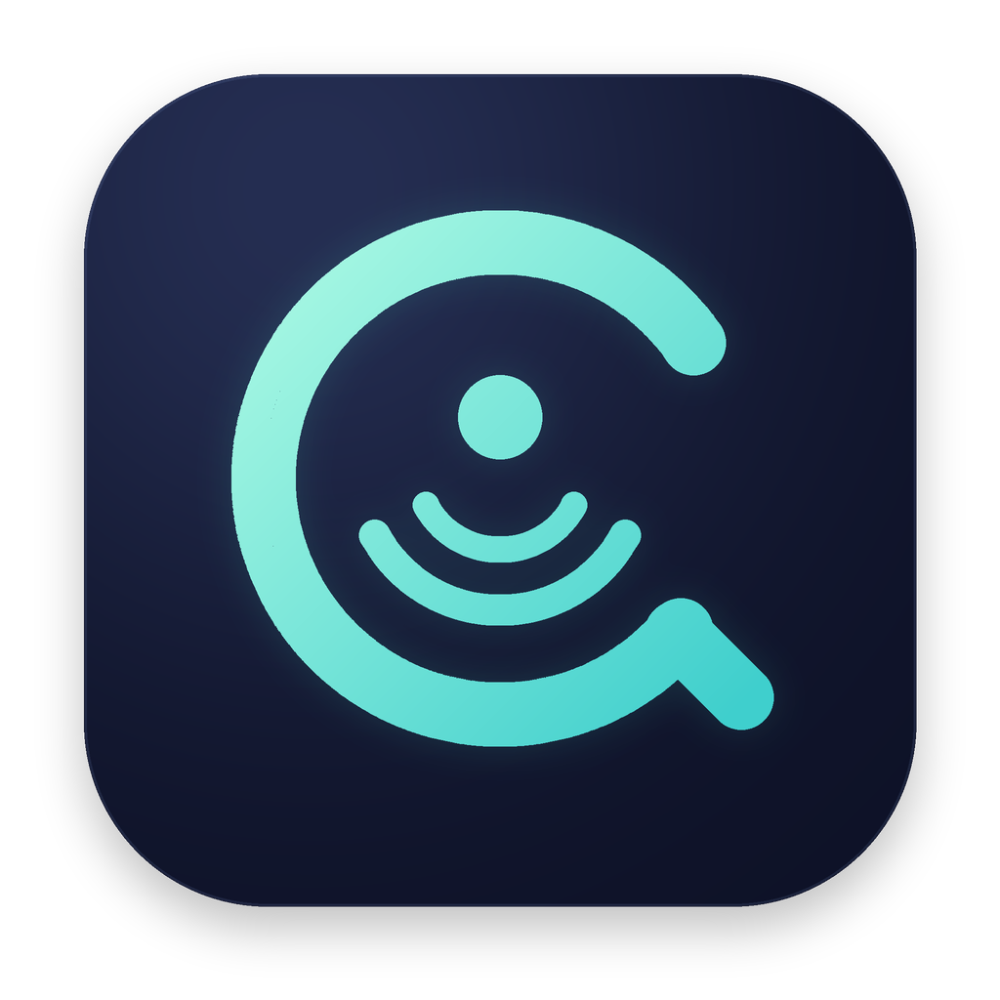

# QuotaNest · 额度巢



macOS 菜单栏 AI 额度与账号管理 App，原名 TokenHUD。每个账号以 **Auth 认证调用／API Key 调用**为基础接入，用量查询统一继承同一认证，定时 API 调用用于尝试主动开启动态 5h 窗口，提高工作时间内的额度利用机会。

当前需求与技术契约以 [2026-11-04 三层需求](docs/account-management-rebuild.md) 为准。该文档区分目标与待验项；Auth 与认证继承改造的最终结果须由本轮验证证明，不能从本 README 推断所有供应商已经真实联通。

## 使用

- 单击菜单栏打开／关闭账号快览，双击切换悬浮速览，右键打开常用操作菜单。
- “设置与外观 → 语言”可切换简体中文／English，立即生效并保存；账号名称、模型ID和供应商返回的原始内容保留原样。
- “设置与外观 → Claude Code HUD”可逐账号勾选显示，与“供应商 → 显示”的 HUD 开关共用同一配置；修改立即同步，写入失败时恢复原选择，停用账号保留偏好。
- 悬浮窗任意位置按住拖动可移动；标题默认隐藏，点击悬浮窗后显示，鼠标移出 5 秒后隐藏，移回时取消待隐藏计时。
- 在账号管理选择“添加账号”→内置供应商类型，可按供应商名称搜索；选择类型只创建草稿，新增模板不会自动创建账号。
- 填写账号名称，再按该类型实际提供的模式填写基础 API Key，或填写／选择已有 Auth 文件；保存后采用类型内置的默认查询，无需填写查询脚本、额外 Token 或查询凭证。没有默认 Auth 来源的类型需要明确选择文件，不能留空自动猜测账号。
- 认证模式按类型能力显示。Auth 只读取类型已声明的 JSON 格式；各类型支持的来源和字段映射见[供应商目录](docs/provider-catalog.md)。明文导出文件可用，不等于已能自动导入原客户端的 Keychain、SQLite、TOML 或加密凭证；App不提供浏览器 OAuth 登录，也不自动刷新或写回外部 Token。
- 用量查询继承同一基础认证。当前55个内置类型按实际声明分为22个“查询加模型调用”和33个“仅查询”；仅查询类型尚未接入模型调用协议，不能测试模型或设置调度，这不表示用户漏填 API Key。完整分类和17个不启用候选见[供应商目录](docs/provider-catalog.md)。
- 支持模型调用的类型，新模板的模型默认留空；请为目标套餐／用量池选择实际模型后再测试或启用计划。复制账号可沿用非敏感配置，所有凭证需重新填写，计划默认暂停。
- 定时小请求用于尝试主动开启按首次使用计时的动态 5h 窗口，不是强制 reset 或余额刷新；例如工作 09:00–18:00 时可考虑 05:00／10:00／15:00，但效果取决于真实供应商机制。调度模型必须适用于目标套餐／用量池，不能只按名称看起来便宜来推荐。
- 每个账号可控制菜单／悬浮窗展示及 Claude HUD 输出；同类型账号使用各自缓存和稳定标识。

## 开发与验证

必须使用 swiftly 工具链：

```zsh
export PATH="$HOME/.swiftly/bin:$PATH"
swiftly run swift build
swiftly run swift test
node --test scripts/test-account-query-providers.mjs scripts/test-provider-web-parsing.mjs
node --test scripts/test-gpt-provider.mjs scripts/test-cline-provider.mjs
```

离线演示截图不会启动真实账号查询和计划：

```zsh
TOKENHUD_RENDER="$PWD/.build/account-preview" .build/debug/TokenHUD
```

## 打包安装

```zsh
zsh scripts/package.sh
open ~/Applications/QuotaNest.app
```

打包会安装带完整 macOS 图标的 QuotaNest，并在新包验证成功后移除旧 TokenHUD 应用包；需先退出运行中的 App。内部可执行目标、Bundle ID、偏好与账号目录保留兼容标识，已有账号和来源引用无需迁移。

## 供应商类型与账号

内置类型来自 `Sources/TokenHUD/providers/`。每个类型提供 `manifest.json`、`fetch.sh` 和默认配置；协议、固定地址和查询逻辑由类型提供，主框架自动扫描，不按供应商名称分支。

账号实例位于 `~/Library/Application Support/TokenHUD/providers/`，通过 `template` 引用类型，独立保存基础接入配置、缓存和调用计划。API Key 等 App 自有凭证写入 Claude 配置目录的 `hud` 子目录，权限为 0600；支持 `CLAUDE_CONFIG_DIR`。Auth 按只读 CLI／JSON 来源使用，不擅自写回外部授权来源。

用量查询统一继承基础 Auth／API Key。保存时应清理旧查询字段，同时保留基础 API Key 和授权文件引用；无需用户手工删除旧数据。旧网页查询已不再是当前启用方案，其取证和离线样本保留在 [历史网页查询契约](docs/provider-web-query-contracts.md)，仅供历史追溯。

## 导入已有账号：只读来源引用

在导入中心选择 9router、cc-switch、CPAMP 或 Magpie，扫描后勾选预览中可导入的记录。导入只保存来源路径、原始记录和供应商身份，不把 Auth／API Key 复制进 TokenHUD 账号文件；文件按原路径引用，数据库按记录主键只读查询。每次请求重新解析当前来源并冻结本次内存快照，源里的凭证变化会用于后续请求；记录删除、来源缺失或类型不匹配时显示不可用，不回退旧副本。

| 来源 | 当前范围 |
|---|---|
| 9router | 按连接记录主键与原 providerID 绑定，认证格式须匹配已适配类型；不代表所有路由供应商均可导入。 |
| cc-switch | 当前支持 Claude 命名空间的记录，身份包含 `id + app_type`；其它类型可预览，但标为不支持。 |
| CPAMP | 引用既有 CPA JSON 文件，按文件名和 `type` 校验；仅支持已有模板及其声明的认证格式。 |
| Magpie | 默认读取绝对 `XDG_CONFIG_HOME` 下的 magpie 目录，否则使用 `~/.config/magpie`；界面可选择显式配置根目录，包括 portable data。支持已适配的 provider Key 与插件凭证槽，保留原 providerID；原生 logins 的 CLI／Keychain 持有凭证不支持，不自动登录或刷新。 |

导入账号的名称、认证、地址、模型和计划配置只读，请到来源工具修改；本地仍可启停账号、调整显示、查询或删除关联，删除关联不改来源。内置模板固定调用协议与地址；通用来源账号的显式协议、地址随源记录更新，界面隐藏 URL 中的用户信息和查询参数。旧导入账号会先锁定，可重新扫描并转换为实时引用，保留原账号标识并清理旧本地 Key。来源变化会隔离旧缓存与迟到结果；HUD只接收安全依赖路径和修改时间，不查询来源数据库中的秘密。

## 自定义额度接口

自定义供应商保留 OpenAI 兼容和 Anthropic 兼容两种调用协议，仅支持基础 API Key，不支持自定义 Auth 文件。配置基础调用地址、模型及完整额度查询 URL；默认查询契约为 HTTP GET，继承同一基础 Key，返回标准 JSON。不提供独立查询 Key／Token／Cookie，不要求自写查询脚本，也不自动猜测 billing 路径。未提供真实额度查询接口的供应商不列入内置额度类型；Groq仅有速率头，已不启用。标准 JSON 解析接受以下格式，也支持 `data` 包装：

```json
{
  "five_hour": { "used_percentage": 25, "resets_at": 1793462400 },
  "seven_day": { "used_percentage": 40 },
  "windows": [
    { "label": "本月", "amount": 12, "limit": 50, "unit": "USD" }
  ]
}
```

窗口与重置时间可以缺省。缺失数据保持未知；失败时只有确认同账号身份的旧数据才会保留，并标为旧值。

## Claude Code HUD

在账号的展示页选择需要同步的账号，再使用“写入 HUD”。App 为每个账号写入动态缓存映射并合并 `settings.json` 的 `ACCOUNT_ENVS`，保留其他工具的账号条目。HUD 渲染只读取这些 App 管理的快照。

本轮需求、改造边界与验证重点见 [账号管理重构说明](docs/account-management-rebuild.md)，实测结果和未验项见 [交付验证记录](docs/account-management-verification.md)。
