<p align="center">
  
</p>
<h1 align="center">QuotaNest · 额度巢</h1>
<p align="center">额度悬浮窗 + Claude Code HUD + 动态 5h 窗口调度，配合已有 AI 工具使用。</p>
<p align="center">
  <a href="README.md"></a>
</p>
<p align="center">
  <a href="https://github.com/biedongbin/QuotaNest/releases/tag/v1.0.0"></a>
  
  
  
  
</p>

> 原生 macOS 辅助应用，核心解决两件事：让额度显示在悬浮窗和 Claude Code HUD 中，以及用定时小调用尝试启动部分供应商的动态 5h 窗口。

## 10 秒了解

1. **额度随时可见。** 把已有账号的额度、用量和重置时间显示在悬浮窗与 Claude Code HUD 中，不必反复打开供应商后台。
2. **安排动态 5h 窗口的启动时机。** 对于按首次有效请求开始计时的供应商，在选定时间调度小请求，尝试启动下一窗口，让额度刷新节奏更贴近工作时间。效果取决于供应商规则；这不是强制重置，不保证开窗，调用也可能消耗额度。

**QuotaNest 不是 API 网关，不代理、路由或负载均衡你的业务请求。** 它是 Magpie、CPAMP、9router、cc-switch 等现有 AI 网关和账号管理工具的配套辅助应用，承担额度展示与定时调度的角色。

**已经配好的凭证和 API Key 可以直接复用。** 对于已适配的来源与认证格式，导入时只保存来源引用，无需为 QuotaNest 再录入或长期复制一份凭证；后续请求从源工具的配置解析当前认证。来源工具继续负责连接和凭证配置，QuotaNest 补上悬浮窗、Claude Code HUD 和计划调用能力。

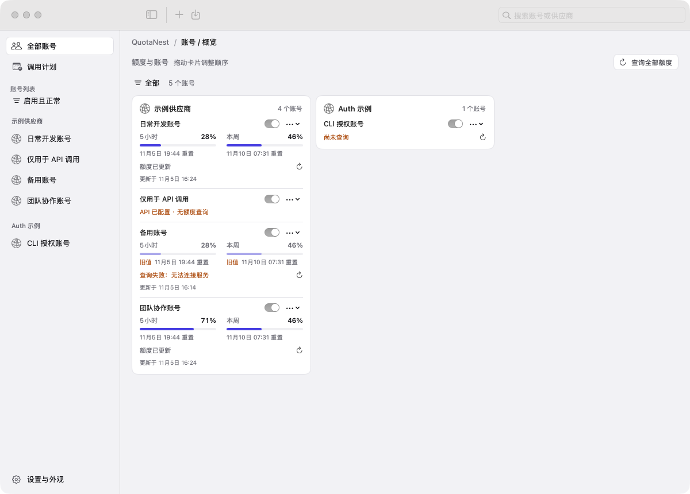

## 演示视频 · 27 秒

https://github.com/user-attachments/assets/1610e425-4907-4c66-9429-bfac23de6a3e

[观看／下载中文 MP4](docs/videos/quotanest-demo-zh-CN.mp4) · [English video](docs/videos/quotanest-demo-en.mp4)

视频展示当前原生 App，使用隔离的示例账号和演示额度，不发起付费模型请求。制作沿用 [CCS](https://github.com/biedongbin/claude-code-session-manager) 最终采用的“真实截图 → GSAP → HyperFrames”链路；复现源文件、具体工具和取证说明见 [视频制作说明](docs/video-source/README.md)。

## 功能一览

| 能力 | 具体用途 |
| --- | --- |
| 四种悬浮样式 | 卡片、玻璃、紧凑、列表；任意位置拖动，点击显示标题，离开 5 秒后隐藏。 |
| Claude Code HUD | 在全局设置或账号展示页勾选输出账号，两处共用同一配置。 |
| 定时小调用 | 按本机时间执行请求，尝试启动适用套餐的动态用量窗口；请求消耗额度，不保证开启或重置窗口。 |
| 只读导入 | 引用 9router、cc-switch、CPAMP、Magpie 的既有记录，保留原始记录 ID 和 provider ID。 |
| 多账号概览 | 集中查看额度窗口、余额、重置时间、旧数据和配置状态。 |
| 55 个内置类型 | 当前 22 个类型声明“额度查询＋模型调用”，33 个类型仅支持额度查询；详见[供应商目录](docs/provider-catalog.md)。 |
| Auth／API Key | 认证方式由供应商类型声明，用量查询继承同一基础认证。 |
| 来源同步 | App 运行期间每小时检查，也可立即同步；只有唯一确认身份后才订正变化的源记录 ID。 |
| 中英双语 | 在“设置与外观”即时切换简体中文／English，外观跟随 macOS 浅色／深色。 |
| 历史配置迁移 | 将旧 TokenHUD 账号与偏好迁入 QuotaNest，包含校验、备份及失败回滚。 |

## 安装

**Homebrew（推荐）：**

```zsh
brew install --cask biedongbin/tap/quotanest
```

cask 支持 **macOS 14+ 的 Apple Silicon 和 Intel**，并安装额度适配脚本所需的 Node.js。参考 [CpampBar](https://github.com/biedongbin/cpamp-start-bar) 的方式，仅移除已安装 QuotaNest 应用的隔离属性。应用使用 ad-hoc 签名，未进行 Apple Developer ID 签名或公证。

后续版本使用 `brew upgrade --cask quotanest`。如需安装到用户目录，可附加 `--appdir="$HOME/Applications"`；交给 Homebrew 管理前，请先退出并移走旧的手工安装 App 包。账号数据独立存储，不在 App 包内。

**手动下载：** 从 [Release v1.0.0](https://github.com/biedongbin/QuotaNest/releases/tag/v1.0.0) 下载 [QuotaNest-1.0.0-universal.zip](https://github.com/biedongbin/QuotaNest/releases/download/v1.0.0/QuotaNest-1.0.0-universal.zip)，按 `SHA256SUMS` 校验后解压，将 `QuotaNest.app` 放入 Applications。首次启动可能需要在“系统设置 → 隐私与安全性”中允许打开。

### 从源码构建

需要 **macOS 14+**、**Swiftly 管理的 Swift 工具链**，以及供额度适配脚本使用的 **Node.js**，建议 Node.js 18+。

```zsh
git clone https://github.com/biedongbin/QuotaNest.git
cd QuotaNest
export PATH="$HOME/.swiftly/bin:$PATH"
zsh scripts/package.sh
open ~/Applications/QuotaNest.app
```

打包前先退出正在运行的 App。脚本会构建本地应用、打包图标和资源、进行 ad-hoc 签名，并安装到 `~/Applications`。这是本机构建流程，不代表已经提供经过公证的安装包下载。

系统 Command Line Tools 的 Swift 可能与当前包的 Manifest ABI 不兼容；请使用 `swiftly run swift …`，不要在构建中混用工具链。

## 核心界面

以下截图使用隔离演示数据，不包含私人凭证，也不代表已实测每个供应商的联通性。用户账号名称及供应商返回的原始内容不会随语言设置自动翻译。

### 1. 选择供应商类型

搜索内置类型，先看支持的认证方式和查询／调用能力。选择类型只打开草稿，不会立即创建账号。

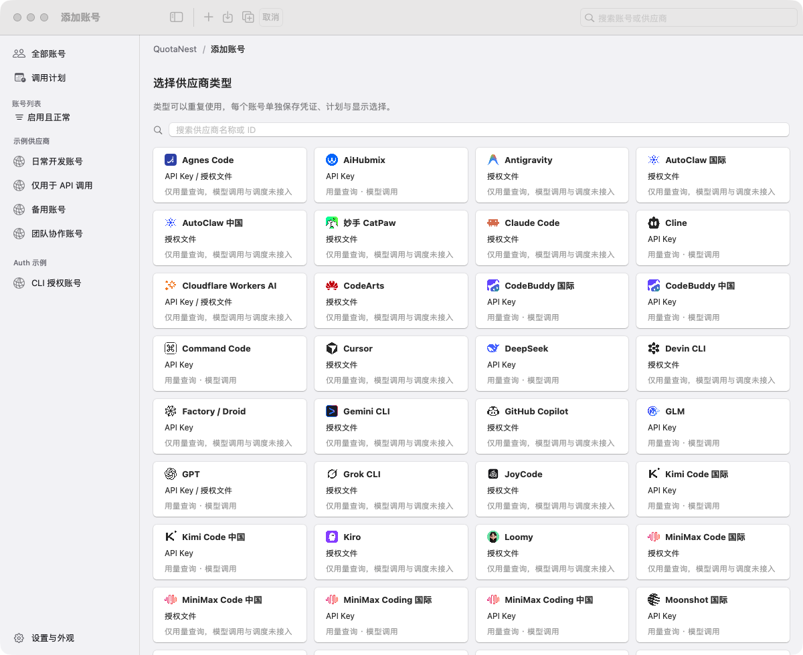

### 2. 配置 API Key 或引用已有 Auth

每个类型决定支持哪些认证方式。Auth 引用已声明格式的 JSON 授权文件；API Key 使用基础连接。额度查询复用同一认证，无需再填一套独立查询 Key。

| API Key 基础连接 | 已有 Auth 文件 |
| --- | --- |
| 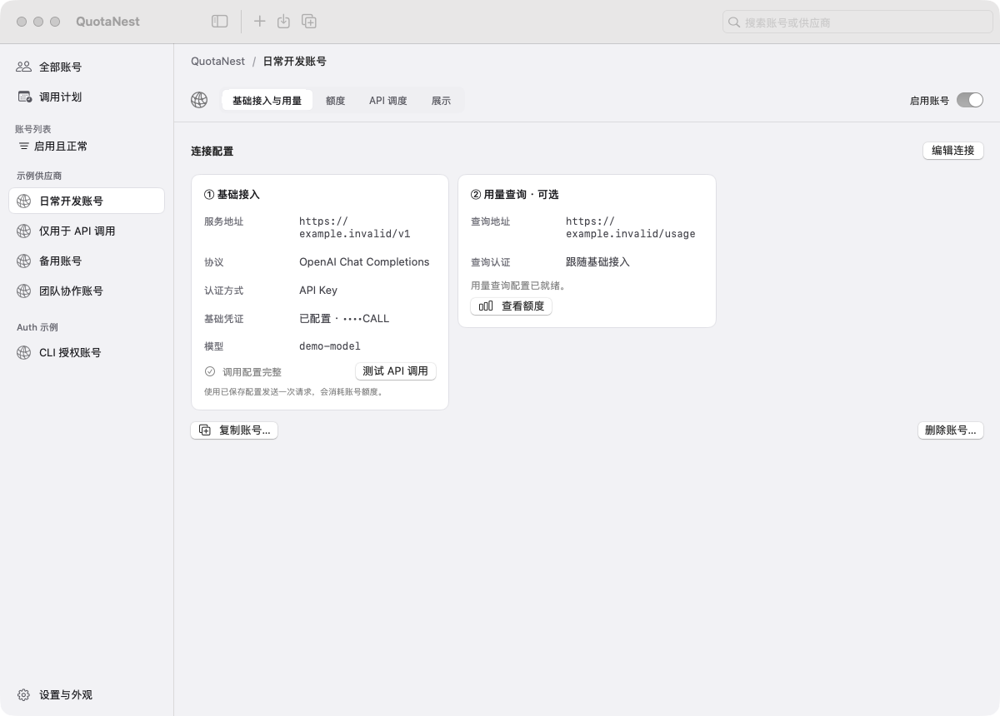 | 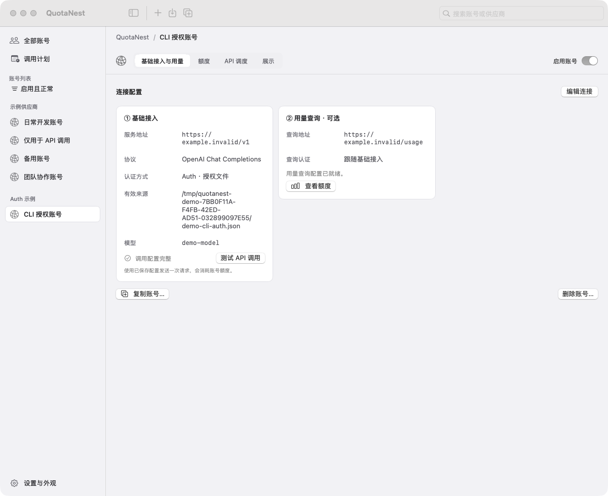 |

<details>
<summary>展开查看：账号编辑与仅 API 账号</summary>

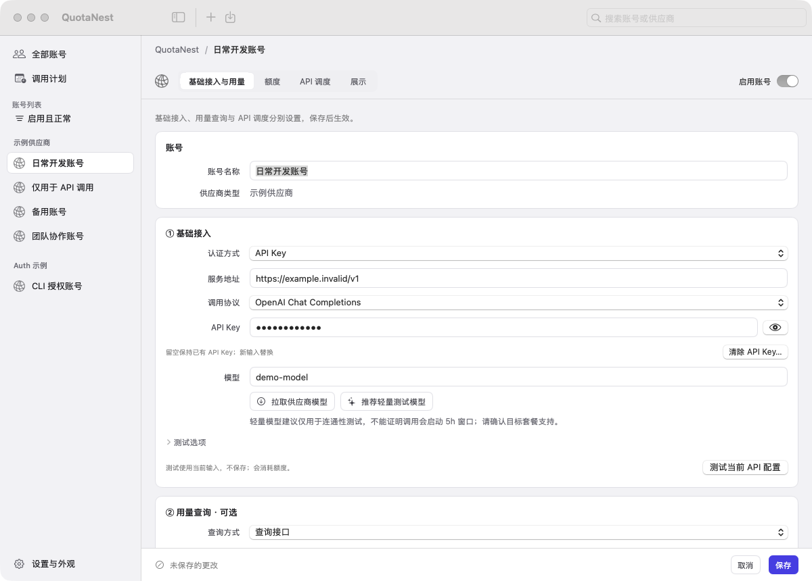

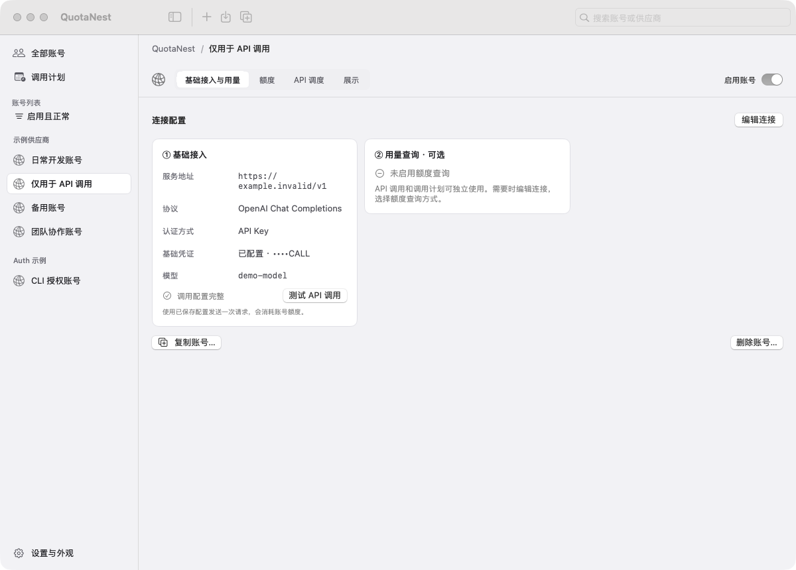

</details>

### 3. 查看额度和设置调用计划

额度详情区分计费窗口和账号身份。缺失值保持未知，失败查询不会伪装成刷新成功。

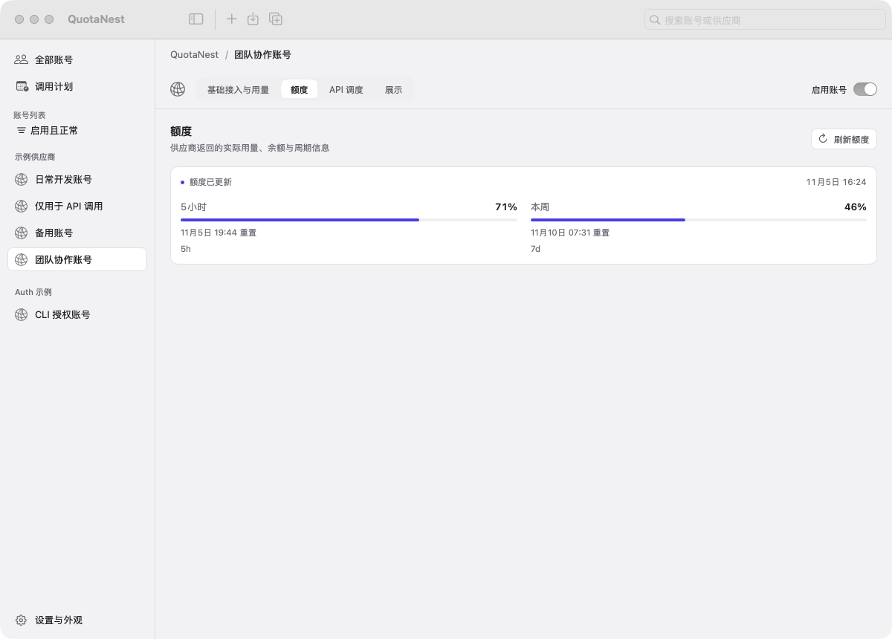

支持调用的类型可以选择目标套餐／额度池适用的模型，再设置本机时间计划。小请求只会**尝试**开启供应商支持的首次使用计时窗口，不是重置指令；每次调用都可能消耗额度。

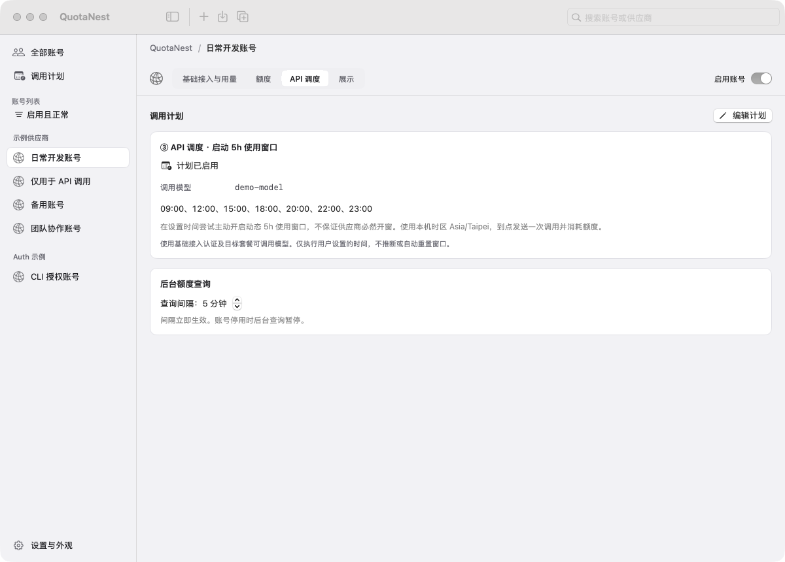

<details>
<summary>展开查看：全部调用计划</summary>

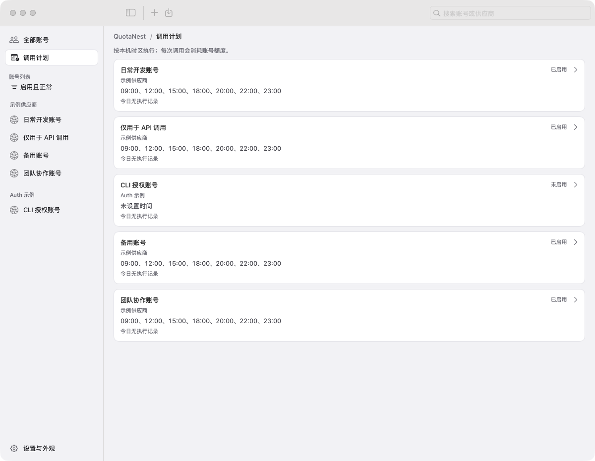

</details>

### 4. 导入已有账号

预览展示来源工具、供应商身份、源记录 ID、认证方式、额度适配及导入状态。不支持或未适配的行置灰不可选；滚动时列标题保持可见。

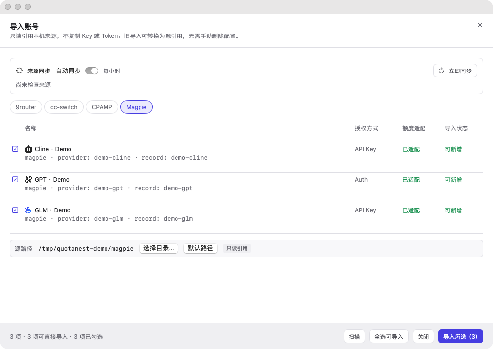

| 来源 | 当前支持边界 |
| --- | --- |
| 9router | 按 `providerConnections` 原主键与 provider 身份引用，认证结构必须已适配。 |
| cc-switch | 当前支持 Claude 命名空间，按 `id + app_type` 识别；其他命名空间显示不支持。 |
| CPAMP | 按文件名和类型引用已支持的 CPA JSON 授权文件。 |
| Magpie | 支持已适配的 provider Key 与插件凭证槽，保留原 provider ID，可选择 portable 配置目录；原生 CLI／Keychain 持有的登录不导入。 |

导入账号的连接字段只读，请到来源工具维护凭证；本地仍可控制启停、显示、查询和删除关联。删除关联不删除源数据。

自动同步只在 **QuotaNest 运行期间**每小时执行。源记录 ID 变化时，必须唯一确认身份且类型／协议兼容才订正。候选歧义、缺少证据，或 ID 与 Token 同时变化但无可信关联时，需要人工核对。来源同步不会发起模型调用。

### 5. 四种悬浮窗样式——全部展示

四种样式使用同一套账号数据和供应商品牌映射。彩色 Logo 保留原色，单色 Logo 随外观调整。

| 卡片 | 玻璃 |
| --- | --- |
| 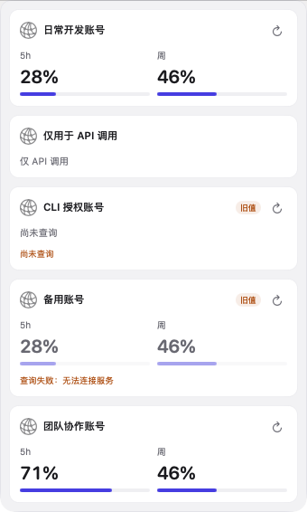 | 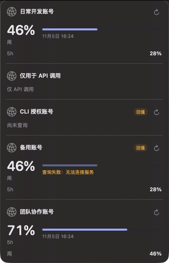 |

| 紧凑 | 列表 |
| --- | --- |
| 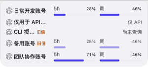 | 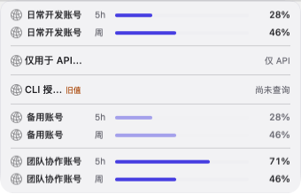 |

- **卡片**：每个账号一个卡片，各额度窗口并列显示。
- **玻璃**：突出最高用量窗口，其他周期作为次级信息展示。
- **紧凑**：小行距、不使用分隔线，适合少占屏幕空间。
- **列表**：名称、周期、进度条和数值分列对齐，账号之间有分隔线。

单击菜单栏项目开关快览，双击切换悬浮窗，右键打开操作菜单。悬浮窗任意位置都可按住拖动；标题默认隐藏，点击后显示，鼠标离开 5 秒后隐藏，移回取消计时。**外观跟随 macOS；当前没有 App 内独立主题切换开关。**

<details>
<summary>展开查看：菜单栏快览</summary>

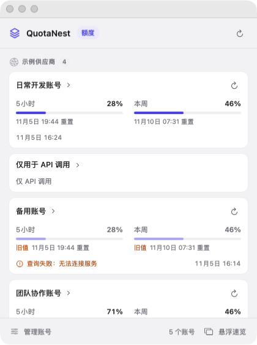

</details>

### 6. 勾选 Claude Code HUD 账号及调整设置

“设置与外观 → Claude Code HUD”支持横向勾选并自动换行，与账号的“展示”页共用同一状态。修改立即同步，HUD 写入失败会恢复原选择；停用账号保留偏好，重新启用后恢复。

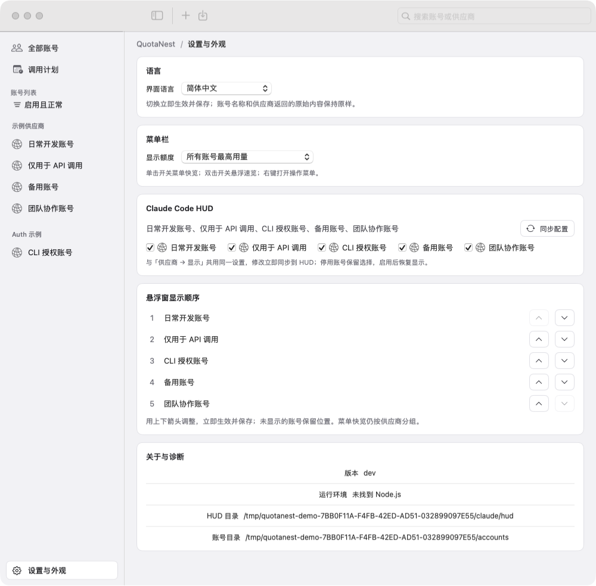

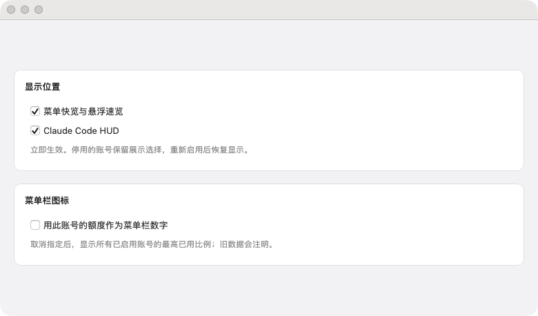

下面是用户补充的 Claude Code HUD 实际输出示例，发布前已裁掉顶部项目目录行，仅保留供应商额度内容。

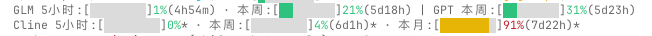

## 数据、认证与历史迁移

| 项目 | 位置／行为 |
| --- | --- |
| 应用 | `~/Applications/QuotaNest.app` |
| 账号清单 | `~/Library/Application Support/QuotaNest/providers/` |
| 偏好域 | `local.quotanest` |
| Claude HUD 集成 | `~/.claude/hud/` 及 Claude 的 `settings.json`，支持 `CLAUDE_CONFIG_DIR`。 |
| 旧 TokenHUD 数据 | 在初始化语言、账号及后台任务前自动迁移；原始数据归档到 `QuotaNest/MigrationBackups/`，并生成迁移报告。 |

导入凭证在本次请求时从来源解析，长期账号配置只保存引用。手工配置的 API Key 属于 App 自有凭证，以受限文件权限存储；外部 Auth 文件不会被自动刷新或覆盖。

不要为了导入而手工把外部授权文件搬入 App 目录。Keychain、加密或未适配的结构，不会因为能导出就自动获得支持；App 不提供浏览器 OAuth 登录流程。

## 自定义额度接口

自定义账号使用 **API Key**，支持 OpenAI 兼容或 Anthropic 兼容模型调用。填写完整额度 URL；默认 HTTP GET 查询继承基础 Key。不提供额外查询 Key／Cookie，也不猜测 billing 路径。

标准额度 JSON 支持以下字段，也可由 `data` 包装：

```json
{
  "five_hour": { "used_percentage": 25, "resets_at": 1793462400 },
  "seven_day": { "used_percentage": 40 },
  "windows": [
    { "label": "本月", "amount": 12, "limit": 50, "unit": "USD" }
  ]
}
```

详细边界见[供应商目录](docs/provider-catalog.md)、[账号与认证契约](docs/account-management-rebuild.md)和[验证记录](docs/account-management-verification.md)。内置适配不等于所有供应商、账号和套餐均已完成真实联通验证。

## 更新日志

- **[更新日志](CHANGELOG.zh-CN.md)** — 按版本号归档的功能与发布记录。
- **[v1.0.0](https://github.com/biedongbin/QuotaNest/releases/tag/v1.0.0)** — 当前正式版本与安装包。

## 致谢

- [Linux.do](https://linux.do) — 社区交流与项目分享。
- [Magpie](https://github.com/yetone/magpie) — 供应商生态与界面参考。
- [CCS](https://github.com/biedongbin/claude-code-session-manager) — README 结构和演示视频制作方式参考。
- [Claude Code](https://claude.com/claude-code) — Claude Code HUD 集成。

## 许可

[MIT](LICENSE)。第三方素材保留各自随附的许可证与声明。
